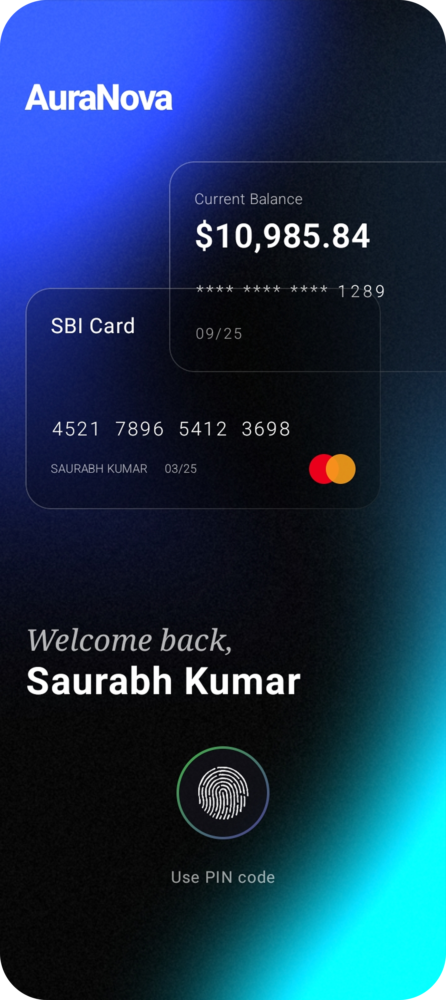
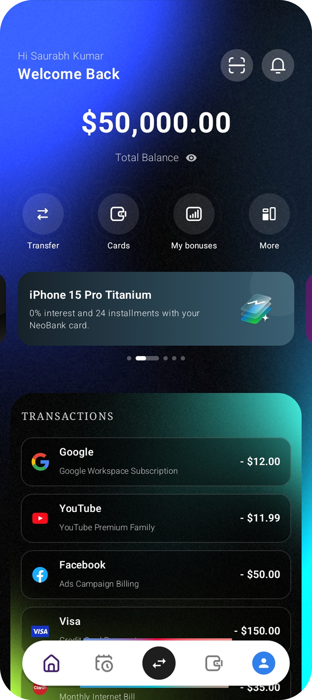
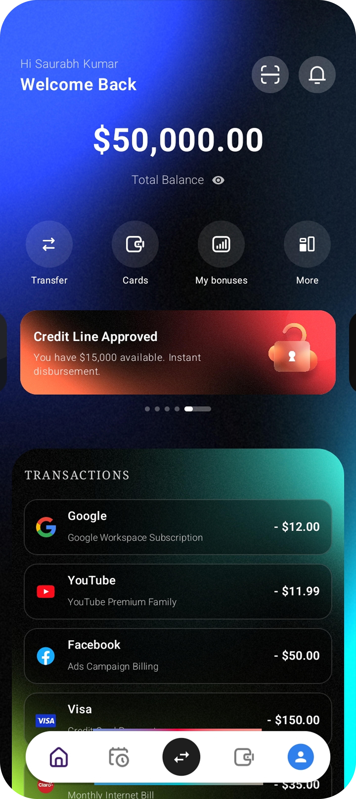
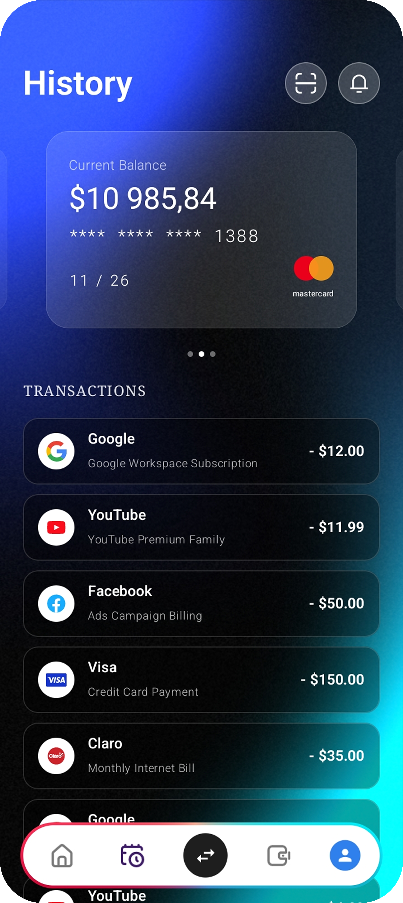

<div align="center">
  

  <h1>NeoBank UI</h1>
  <p><strong>Fintech Interface Showcase built with Kotlin and Jetpack Compose for Android.</strong></p>

[](https://kotlinlang.org)
[](https://www.jetbrains.com/lp/compose-multiplatform/)
[]()
[]()

<p align="center">
  <a href="https://github.com/JastinBolanos/NeoBankUI-KMP/releases/download/v1.2.0/NeoBankUI.apk">
    
  </a>
</p>
</div>

---

## Overview

**AuraNova** is an exploratory financial client interface built with **Kotlin** and **Jetpack Compose** for **Android**. The project demonstrates how modern declarative UI principles and clean component hierarchies can deliver a responsive, premium native experience on mobile devices.

---

## App Preview

### 🔒 Core Banking & Privacy
> Simulated biometric authentication, layered translucent surfaces, and dynamic privacy toggles that obscure sensitive balance details.

| Biometric Auth | Dashboard View | Card Privacy |
| :---: | :---: | :---: |
|  |  |  |

### 💸 Fluid Transactions & Custom UI
> Infinite promotional carousels built with `HorizontalPager`, custom numeric keypads, and structured transaction histories.

| Promotional Banner | Transaction History | Smart Transfer |
| :---: | :---: | :---: |
|  |  |  |

---

## Technical Highlights

* **Core Framework:** Kotlin and Jetpack Compose targeting Android.
* **Architecture:** Clean Architecture with Feature-driven organization and structured State Hoisting.
* **UI/UX Design:** High-fidelity Dark Mode utilizing native Compose canvas modifiers for translucent surfaces, soft shadows, and clean typographic hierarchies.
* **Navigation:** Back-stack handling implemented via Android's `BackHandler` to manage Android system back events consistently.
* **Gesture Interactions:** Smooth gesture handling (`detectHorizontalDragGestures`) paired with coordinated entrance animations (fade-in and slide-up).
* **Continuous Integration:** Automated UI component compilation and Gradle build validation via GitHub Actions.

---

## Getting Started

1. **Clone the repository:**
   ```bash
   git clone https://github.com/JastinBolanos/NeoBank-UI.git
   cd NeoBank-UI
   ```

2. **For Android:** Open the project in Android Studio, select the `app` configuration, and press *Run*.
